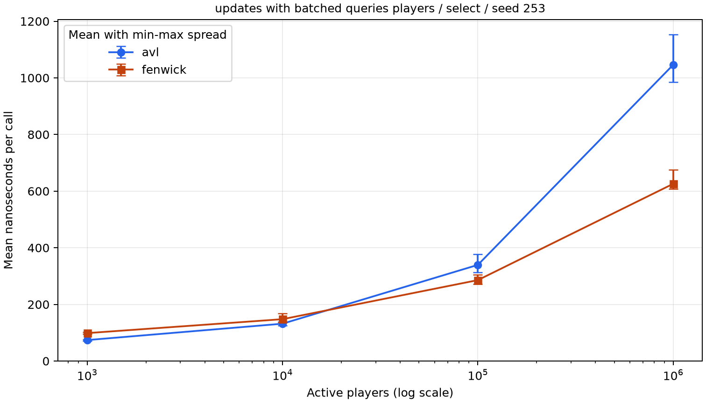
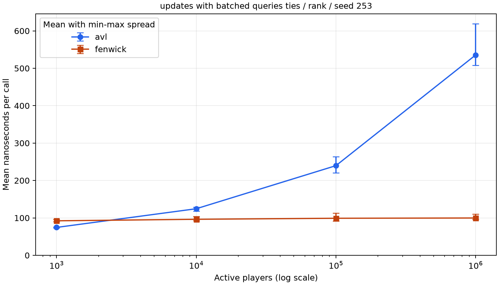
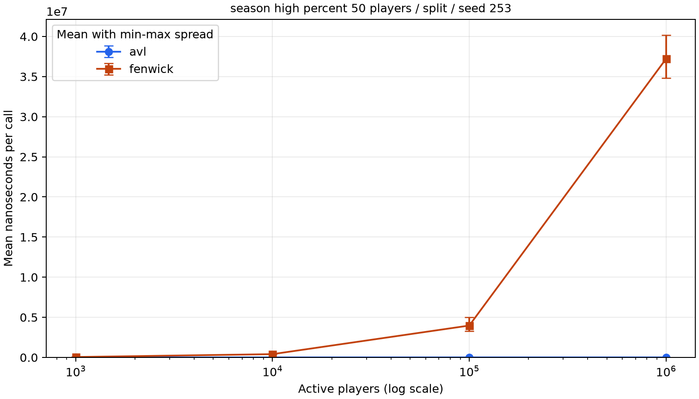

# Analyst experiment report

Author: Sumit. Formal timing suite completed on 17 November 2026.

## Workload and reproducibility

The full suite compares both actual backends at 1,000, 10,000, 100,000 and 1,000,000 players. Each query experiment performs one million actual score revisions, one million rank queries and one million select queries. The sequence uses blocks of up to 256 revisions followed by rank and select batches. The two score policies supply U=n and U=min(n,1000). Ordinary experiments use seed 253 and five repetitions. The supplied mixed traces additionally use generator seeds 42 and 20261115.

Machine reported by Windows is 12th Gen Intel(R) Core(TM) i5-1235U, 10 cores and 12 logical processors. Windows reports aggregate L2 cache 6656 KiB and L3 cache 12288 KiB. These readings are preserved in the metadata. Measurements are elapsed batch means and include loop/checksum work.

The benchmark compiler and exact flags are recorded in the build manifest. Both structures and the reference compile as C++ with the same benchmark compiler. Bianca's exact generator source was compiled separately with portable Zig/Clang because the installed MinGW lacks its newer C++17 syntax.

D6 was written before these formal runs. Its Fenwick revision `0d5ad68` has identical `src/structB/fenwick.cpp` content to the measured `2d758ef`; its query/split/merge models still apply. The newer Oracle supplies correctness checks outside the timing windows.

| Component | Commit |
| --- | --- |
| architect | `a4dc4382b11d60ed85697fb9560574d24a8d2366` |
| avl | `03f3f57186f96bac6b2ad8f22acbedd7da2de153` |
| fenwick | `2d758efdc7bdd69587981c0c3f44bf26984a7801` |
| oracle | `f3f8c29cb357a29a46ad5a654f7d5fac390aceea` |
| adversary | `a788f1783fa3b2fcacd5cbaeb32236a8c5f12be5` |

Raw observations, settings, code hashes, seeds, machine data and commands are in [metadata.json](results/full-20261117-final/metadata.json), [summary.csv](results/full-20261117-final/summary.csv) and the [raw CSV directory](results/full-20261117-final/raw/). The plots are regenerated by `python results/plot.py results/full-20261117-final`.

## Rank and select

The table gives mean nanoseconds per core query with [minimum, maximum] across five run averages at one million players.

| Score policy | Operation | AVL ns/call | Fenwick ns/call |
| --- | --- | ---: | ---: |
| U=1,000,000 | rank | 939.02 [887.25, 1,027.78] | 342.74 [326.31, 372.69] |
| U=1,000,000 | select | 1,046.16 [984.33, 1,152.56] | 625.85 [607.24, 674.97] |
| U=1,000 | rank | 535.40 [508.20, 618.70] | 99.74 [95.96, 110.09] |
| U=1,000 | select | 1,119.15 [1,088.70, 1,195.14] | 126.76 [115.08, 143.09] |

D6 predicts O(log n) AVL paths and O(log U) Fenwick queries. The fixed-U experiments separate coordinate-count growth from player-count growth. Actual constants also include binary search, pointer/array accesses and the measured call path. These data alone do not establish a cache explanation.

## Split and rejoin

The table reports the requested 50% high-division case at one million players. Cutoff ties can change the actual split size. Each public API includes its own allocations/validation. Inputs are prepared before timing and all output players are checked afterwards.

| Score policy | Operation | AVL ns/call | Fenwick ns/call |
| --- | --- | ---: | ---: |
| U=1,000,000 | split | 5,760.00 [4,200.00, 7,100.00] | 37,210,760.00 [34,840,000.00, 40,151,200.00] |
| U=1,000,000 | rejoin_merge_from | 8,200.00 [7,600.00, 9,000.00] | 286,053,120.00 [251,384,700.00, 331,815,700.00] |
| U=1,000 | split | 4,120.00 [3,600.00, 4,800.00] | 41,740.00 [31,700.00, 51,900.00] |
| U=1,000 | rejoin_merge_from | 8,080.00 [7,300.00, 9,600.00] | 85,192,720.00 [81,788,400.00, 93,592,600.00] |

The AVL split uses joins along a search path, while Fenwick creates/rebuilds coordinate arrays. Public AVL rejoin includes boundary searches and pivot extraction. Public Fenwick merge sorts IDs for conflict checking in addition to combining buckets and rebuilding counts. This is why D6 models the measured public merge with an N log N term.

With one million players, fixed-U Fenwick split takes about 41.7 microseconds compared with 37.2 milliseconds for U=n. This agrees with D6's O(U) model for this implementation: bucket storage is moved, so split does not copy each player. Its public merge still processes player IDs and takes about 85.2 milliseconds at fixed U. AVL split/rejoin remain much smaller. Small timing differences and the supplied-pivot join's nonmonotonic timings cannot be predicted from Big-O alone; allocation, loop overhead and run variation matter. Four sizes and five repetitions provide a comparison for this workload, rather than a fitted universal timing law.

## Ordered AVL join

The pivot is supplied before the timer, and the helper performs no boundary scans. These deterministic input trees have one million players including the pivot. Mean primitive visits are calculated from the exposed visit totals and call counts.

| Requested left percentage | Left height | Right height | Mean ns/join [min, max] | Visits/join |
| ---: | ---: | ---: | ---: | ---: |
| 0 | 0 | 20 | 5,160.00 [3,600.00, 8,700.00] | 20.0 |
| 1 | 14 | 20 | 1,800.00 [1,600.00, 2,100.00] | 6.0 |
| 50 | 19 | 19 | 780.00 [600.00, 1,000.00] | 1.0 |
| 99 | 20 | 14 | 1,820.00 [900.00, 3,200.00] | 6.0 |
| 100 | 20 | 0 | 1,380.00 [1,000.00, 2,700.00] | 20.0 |

D6 predicts a fixed setup/allocation term plus work proportional to the input height difference. The visit counter is direct algorithmic evidence; elapsed time also contains fixed overhead and run-to-run noise.

## Counters and adversarial inputs

The revision counter experiment performs 1,000 real score changes after construction. Counts are recorded in untimed runs. Initial IDs are inserted in increasing order, so Fenwick construction appends within each bucket and has zero bucket shifts.

| Players | AVL revision rotations | Fenwick revision ID shifts |
| ---: | ---: | ---: |
| 1,000 | 975 | 1,014 |
| 10,000 | 1,006 | 10,079 |
| 100,000 | 699 | 98,335 |
| 1,000,000 | 340 | 983,873 |

Seventeen supplied/generated adversarial traces were replayed on both backends for five repetitions. They include the deletion cascade, all rotation patterns, ties, churn, extreme values, seasons, unequal joins, invalid commands, three mixed seeds and the million-player/million-revision scale trace. All small inputs passed real-oracle checks before formal timing. Full-scale outputs matched both backends and the Adversary's independent expected-output calculation. The large scale input has 2,003,019 commands. Trace measurements include per-call clock overhead and are separately labelled.

The trace CSV seed field is the suite setting; the actual trace-generation seeds are in the input provenance. Input provenance and generation commands are in [adversary-inputs.json](results/full-20261117-final/adversary-inputs.json). Small replay files are saved in [inputs/](results/full-20261117-final/inputs/). The large file is regenerated from the recorded commit/command rather than duplicated in Git. The independent output check is recorded in [postchecks.json](results/full-20261117-final/postchecks.json).

## Cache profiling

Four separate ten-second diagnostic query phases were recorded after setup, at one million players and one million score coordinates. WPR sampled the exposed `LLCMisses` event at interval 65,536. Windows tracerpt decoded the events; the installed WMI schema is saved with the recordings. Thread lifecycle records map payload thread IDs to each benchmark PID. PMU header PID/TID fields alone cannot identify the process reliably.

| Backend | Operation | Queries completed | Decoded benchmark samples | Samples per million queries | Reported lost events |
| --- | --- | ---: | ---: | ---: | ---: |
| AVL | rank | 8,716,288 | 2,488 | 285.44 | 0 |
| AVL | select | 8,126,464 | 3,403 | 418.76 | 0 |
| Fenwick | rank | 21,102,592 | 11,436 | 541.92 | 0 |
| Fenwick | select | 12,845,056 | 8,133 | 633.16 | 0 |

The saved [analysis](results/full-20261117-final/profiles/analysis.json) records query counts, source ID, interval, ETL hashes, benchmark threads and lost-event status. Each capture directory contains its ETL, WPRP, metadata, event summary and filtered `benchmark-samples.csv`. The filtering script is [bench/analyze_profiles.py](bench/analyze_profiles.py). Tracerpt's aggregate PMU counts exceed decoded CSV counts by 3, 2 and 1 events for AVL rank, AVL select and Fenwick rank respectively; Fenwick select agrees. The table deliberately uses decoded, attributable samples.

These captures include query-loop/checksum work and OS execution on benchmark threads, with no function attribution. They are single diagnostic captures, separate from the five-run timing suite. They are samples rather than exact miss totals or cache miss rates. Fenwick has more sampled LLCMisses per completed query in these captures despite faster measured queries, so these observations do not support a claim that fewer last-level cache misses explain its speed. No L1/L2 hit-rate claim is made. See [Microsoft's PMU recording guide](https://learn.microsoft.com/en-us/windows-hardware/test/wpt/recording-pmu-events) for the recording mechanism.

## Interpretation and limitations

The measurements test the growth predicted in D6 using the actual implementations. They include always-enabled owner counters and batch-loop/checksum overhead. The workload is reproducible for the recorded seed and query mix; other distributions may give different constants. Large ordinary runs use snapshots, sampled final queries and cross-backend checksums. The independent scale calculation adds a complete output check for that specific adversarial replay. These measurements complement the Oracle owner's structural/differential correctness tests.
