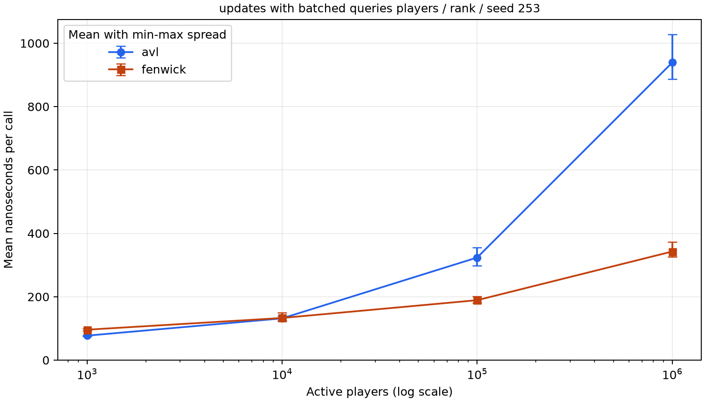
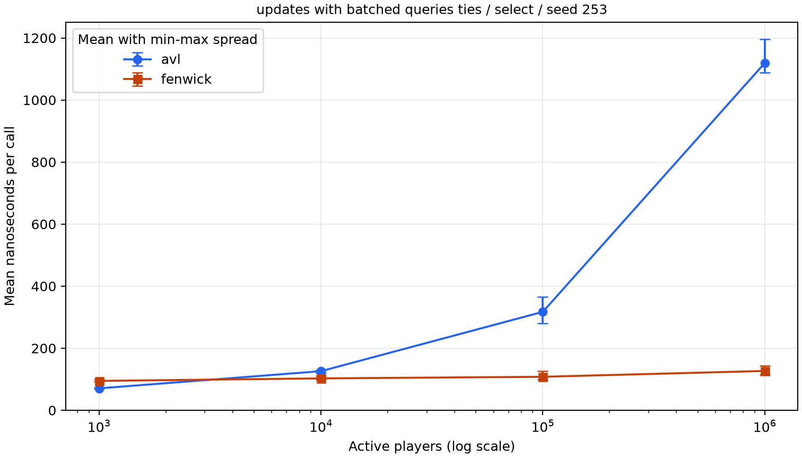
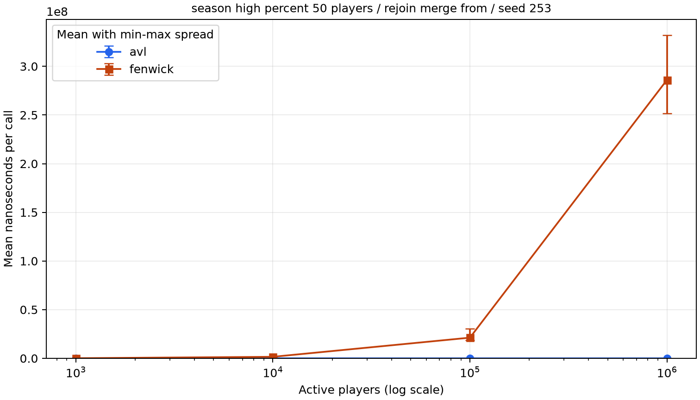

# Project 02: Rank Queries on a Live Leaderboard

This report combines the work of team **PEAKY BLINDERS** with the Analyst's recorded experiment. All reported measurements below are from the preserved five-run dataset, not estimates made for this integration pass.

## 1. Team and contributions

| Member | Roll | Role | Main contribution | Reviewed PR |
| --- | --- | --- | --- | --- |
| Chavda Kalpeshbhai Prince | 250041011 | Structure A | Augmented AVL, ordered join, split, D1 | [#8](https://github.com/pachisiamadhav26-eng/DSA_PROJECT/pull/8) |
| Saksham Bhatia | 250041034 | Structure B | Compressed-score Fenwick, binary-lifting select, D2 | [#7](https://github.com/pachisiamadhav26-eng/DSA_PROJECT/pull/7) |
| Madhav Pachisia | 250041025 | Architect | Shared contract, player table, replay application, D3 | [#9](https://github.com/pachisiamadhav26-eng/DSA_PROJECT/pull/9) |
| Om Dehariya | 250041029 | Oracle | Sorted-array reference, differential tests, audits, D4 | [#6](https://github.com/pachisiamadhav26-eng/DSA_PROJECT/pull/6) |
| Bianca Jain | 250041008 | Adversary | Adversarial generator, fixtures, D5 | [#4](https://github.com/pachisiamadhav26-eng/DSA_PROJECT/pull/4) |
| Sumit | 250041038 | Analyst | Benchmark, counters, profiles, raw data, figures, D6 | [#5](https://github.com/pachisiamadhav26-eng/DSA_PROJECT/pull/5) |

The team will confirm Sumit's full name and any paired-commit credits before the final tag. The linked PRs show the reviewed branch contributions without rewriting their history.

## 2. Problem and workload

A game has players with signed scores that change while a leaderboard is live. A user asks for a player's competition rank, the player at a display position, or a page such as positions 40 through 50. At season boundaries, the game splits a board at a score threshold and later merges regional boards. Up to one million players and one million revisions are relevant to the project. An individual player's ID is globally unique across active boards.

The challenge is maintaining both ordering and exact state. Equal scores share rank, but `select` must identify one player: we break score ties by increasing player ID. The structures have different strengths. An AVL node stores height and subtree size, so a rank or position follows a tree path. Fenwick stores counts by score coordinate, so a rank becomes a prefix sum and a position becomes binary lifting through counts. For Fenwick, IDs within a tied-score bucket still need an ordered list. This extra work matters for revisions, especially when many players tie.

The application takes a text trace and a backend name. It first collects possible scores for coordinate compression, then replays commands in order. It owns the handwritten ID-to-score table and board IDs. Both backends implement the same C++ `Board` interface. A separate sorted-array Oracle receives the same commands and is used for correctness checks. The full command and output protocol, including errors, is in `INTERFACE.md`.

## 3. Interface and invariants

The shared header `include/leaderboard.hpp` defines `PlayerId` and `Position` as unsigned 64-bit integers, `Score` as signed 64-bit, a `Player` pair, and the virtual `Board` operations. The application handles `ADD`, `SET`, `REMOVE`, `RANK`, `SELECT`, `RANGE`, `SIZE`, `SPLIT`, and `MERGE`. Board zero starts empty. Positions are one-based; zero is invalid. Score order is decreasing, then ID order increasing. Competition rank is one plus the number of players with a strictly higher score. This is the invariant proved in D3; equal scores are excluded from the higher-score count by both structures.

The application table maps each live ID to exactly one current score. Its number of entries equals the total number of active players, and each entry belongs to one active board. A successful split consumes the source board and creates disjoint high and low boards whose union is the original state. A successful merge consumes both sources and creates their union. Invalid commands must leave the state unchanged. The replay checks board existence, membership, destination IDs, and position bounds before calling a backend.

For AVL, each node satisfies the total score-and-ID order, `height = 1 + max(child heights)`, a balance factor in `{-1,0,1}`, and `size = 1 + left size + right size`. Every rotation, deletion, split, and join refreshes the affected metadata. For Fenwick, each bucket contains exactly the IDs at its score in ascending ID order; its count equals that bucket's length; every prefix sum equals the sum of those counts; and the total equals board size. The Oracle's sorted array uses the same order and membership rule. Om's backend audit functions and differential runner test these conditions and compare all returned players with the Oracle.

## 4. Structure A: order-statistic AVL

`src/structA/avl.cpp` stores one node per player. The key is a pair `(score, ID)` ordered for display, with higher scores first. Each node records two child pointers, a height and a subtree size. Search, insert, erase, rank and select follow a path of length `O(log n)` because AVL height is logarithmic. A score revision erases the old key and inserts the new one. The application table supplies the old score, so the AVL does not need its own ID lookup table.

For rank, the implementation counts nodes whose score is strictly greater than the queried score. When the current node has a higher score, its entire left subtree and itself can be counted, and the search continues right. Equal scores are never included. Select compares a one-based position with the left subtree's size: go left, return the node, or subtract `left size + 1` and go right. A range query visits only the requested part of the order. The stored sizes must be refreshed after both single and double rotations, or rank and select can silently become wrong even when the AVL still appears balanced. Om's D4 and invariant checker address that risk.

The beyond-lecture operation is a join of two ordered AVL trees around a pivot. When heights are close, the pivot can connect directly; otherwise the algorithm descends the taller spine until attachment is valid, then rebalances while returning. The supplied-pivot join visits `O(|h1-h2|+1)` nodes; D1 proves the height and size conditions. Split follows one search path and rejoins saved subtrees on the way back. D5 charges each join to increases in the two output heights; those increases telescope, giving `O(log n)` total. A score threshold sends ties to the high board. A general merge of overlapping regional ranges cannot use the ordered-join precondition; the implementation has a separate linear rebuild path. We therefore distinguish public rejoin of separated divisions from the primitive supplied-pivot join in the experiments.

The chosen tree supplies ordered player identity directly and supports fast season restructuring. It uses one node per player and pointer-based traversal, which can cost more memory and locality than a count array. A standard library ordered map would hide the required subtree-size updates and join/split proof, so the implementation uses its own nodes and rotations.

## 5. Structure B: compressed-score Fenwick

`src/structB/fenwick.cpp` prepares a sorted list of possible scores before replay and maps each score to a coordinate. Its Fenwick array stores the number of players at each coordinate. A prefix sum over higher-score coordinates yields the strictly-higher count, and competition rank adds one. For select, a binary-lifting descent finds the first coordinate whose prefix count reaches the requested display position. The remaining offset identifies an ID inside that score's ordered bucket. D2 proves why the descent returns the first qualifying coordinate in `O(log U)` time, where `U` is the number of prepared scores.

Insert and erase update the relevant Fenwick count in `O(log U)` and keep the bucket's ID vector sorted. The vector may shift `t` IDs in a tie group, so a revision can cost `O(log U + t_old + t_new)` rather than just logarithmic count work. This matters when many players share a score. `contains` checks the exact score and ID. The Fenwick audit checks coordinate order, bucket membership, counts and prefix sums against the board's state.

Split and merge show the structure's limitation. A split copies/prepares coordinate arrays and moves buckets into two boards, then rebuilds the count arrays; the implementation does work proportional to `U`. Public merge validates duplicate IDs, merges coordinates and buckets, then rebuilds counts. Its duplicate-ID validation includes sorting and can add `O(N log N)` work for `N` players. This is different from the `O(log n)` AVL split and separated-league rejoin. Fenwick was chosen for compact count-based query work; it deliberately rebuilds for season restructuring instead of hiding that cost in an unrelated tree.

## 6. Requirement beyond the lecture

The project brief points to ordered AVL join and split. The team used the sequential join idea from Blelloch, Ferizovic and Sun: descend the taller tree until the two sides can be joined around a separating pivot, then restore AVL balance. Prince's D1 states the precise height-gap bound and proves size updates. Bianca's D5 shows why repeated joins in a split still total logarithmic work rather than multiplying two logarithms. In the application, a general league merge has no ordering precondition, so it may take a rebuild path; we do not claim the primitive join bound for that operation.

Fenwick's original cumulative-frequency idea supports point count updates and prefix sums. Here scores are compressed in descending order, and select uses binary lifting through the Fenwick counts. The project-specific addition is the ordered ID bucket for ties. Saksham's D2 proves coordinate selection, while Madhav's D3 proves that both backends count strictly higher scores for the same competition rank. These additions are necessary to return an exact player at a position rather than only a score bucket.

## 7. Correctness, differential testing and bug log

`oracle/sorted_array.hpp` maintains a vector in the agreed total display order. On small inputs it can insert and erase by shifting elements; speed is deliberately secondary to an independent, clear reference. Om's `oracle/differential.cpp` replays each command against the Oracle, AVL and Fenwick, compares replies and ordered snapshots, then calls the structural audits. It also reduces a failing trace by command deletion while preserving the failure signature. Four Oracle fixtures exercise basic behavior, errors, seasons and wide IDs. Three Adversary fixtures cover ties, nested splits and extreme IDs/scores. The one-million-command seeded run uses seed 253 with a bounded live population; the separate million-player test checks scale with phase-boundary audits. They test different dimensions and must not be described as one test.

In the integrated build, the four unit tests, Oracle self-test, seven fixture pairs, 10,000 seeded commands and 10,000 players passed. Om's prior full validation records one million seeded commands and a separate one-million-player check on his tested checkout. The final integration run should repeat both on the final commit. The independent full-scale adversarial output check is recorded with the Analyst run's postchecks and input provenance.

| Date | Module | Observed symptom | Found by | Fix commit |
| --- | --- | --- | --- | --- |
| 17 Nov 2026 | Analyst result processing | Distinct traces with the same sizes and operations were grouped together in summaries. | Checking the trace grouping and regenerating figures from unchanged raw timings. | [`71dbe20`](https://github.com/pachisiamadhav26-eng/DSA_PROJECT/commit/71dbe20) |
| 21 Nov 2026 | Architect web launcher | The launch path was stale for the integrated backend. | Running the local web demo. | [`9dae973`](https://github.com/pachisiamadhav26-eng/DSA_PROJECT/commit/9dae973) |

The team should add any other real bug it can identify with its exact fix commit. A synthetic fault used to test the shrinker is a test case, not a discovered production bug.

## 8. Adversarial inputs

`adversary/generator.cpp` produces deterministic traces from a case name, player count, operation count and seed. Rotation cases exercise all four AVL insertion patterns. A descending distinct-score sequence appends keys to one spine; D5 proves that a constant fraction of insertions rotate in a long sequence. A minimum-node AVL construction followed by deletion targets a cascade of height changes. Unequal-height merges put a singleton opposite a taller tree to exercise the join spine. Ties insert decreasing IDs at one score, making front-of-bucket Fenwick shifts visible. Churn alternates removal and insertion; season traces test consumed board IDs, empty divisions and overlap. Extreme scores and wide IDs exercise signed and unsigned boundaries.

The runner's deterministic `mixed` case uses recorded seeds 253, 42 and 20261115. For bounded traces, it uses the Oracle and full audits to catch structural errors after each operation. At scale, it audits at phase boundaries and checks output against a separately calculated expected sequence. The formal Analyst run includes 17 supplied or generated adversarial traces for five repetitions, including a million-player/million-revision trace. The case-specific raw CSVs are under `results/raw/`, and `results/full-20261117-final/adversary-inputs.json` records the generation commands and actual seeds. The trace CSV seed field is a suite setting; it is not a substitute for that input provenance. Measured effects on rotations and bucket shifts are tabulated in section 11.

## 9. Predicted cost model before measuring

Sumit's D6 predictions were committed in [`7b78276`](https://github.com/pachisiamadhav26-eng/DSA_PROJECT/commit/7b78276) before the formal 17 November run. The model is symbolic: AVL rank/select follow one height-bounded path; Fenwick rank/select do coordinate and prefix work bounded by `log U`; AVL split uses telescoping joins; Fenwick split scans `U` coordinates; ordered AVL join scales with the height gap; and public Fenwick merge includes coordinate work and duplicate-ID sorting. It does not assign measured nanosecond coefficients afterward. `docs/derivations/D6_250041038.pdf` gives each term and the measured code path.

The guidelines specifically ask for a draft predicted model in `REPORT.md` at checkpoint `c1`. This repository has no `c1` tag or such historical report commit. We cannot create earlier history retroactively. The earlier D6 commit is the verifiable pre-measurement prediction; this integrated report records that limitation honestly.

## 10. Experimental setup

The formal suite used one Windows machine reported as a 12th Gen Intel Core i5-1235U, with 10 cores, 12 logical processors, aggregate L2 cache 6656 KiB and L3 cache 12288 KiB. Its exact compiler version, flags, component commits, source hashes, settings and commands are retained in `results/full-20261117-final/metadata.json`. Ordinary workloads used seed 253 and five repetitions at 1,000, 10,000, 100,000 and 1,000,000 players. They compared `U=n` with `U=min(n,1000)`. Each million-player query experiment included one million actual revisions and one million rank and select queries, with checks outside the query timer. Timings are batch means per call, not tail latencies. Error bars show min/max across five run averages.

The profiling captures were separate diagnostics, not the timing repetitions. WPR sampled exposed last-level cache-miss events; the saved ETL files and analysis identify benchmark threads and report no lost events. Sampling does not yield exact per-call miss counts or prove why one implementation is faster. The full recorded methods and figures follow.

## 11. Results and comparison with prediction

### Analyst experiment report

Author: Sumit. Formal timing suite completed on 17 November 2026.

This section preserves the Analyst's recorded measurements. Submission copies are in `results/raw/` and `results/figures/`; the timestamped run remains the provenance record. `results/publication.json` verifies each copy against its source.

D6 submission: [D6_250041038.pdf](docs/derivations/D6_250041038.pdf), author Sumit, roll 250041038. The two-page 21 November formatting revision preserves the models first committed in `7b78276` before the formal run. The historical prediction hash in the run records refers to that earlier text, not the reformatted document.

For a plain-language explanation and a guide to the saved files, read [Results — start here](results/full-20261117-final/README.md).

## Workload and reproducibility

The full suite compares both actual backends at 1,000, 10,000, 100,000 and 1,000,000 players. Each query experiment performs one million actual score revisions, one million rank queries and one million select queries. The sequence uses blocks of up to 256 revisions followed by rank and select batches. The two score policies supply U=n and U=min(n,1000). Ordinary experiments use seed 253 and five repetitions. The supplied mixed traces additionally use generator seeds 42 and 20261115.

Machine reported by Windows is 12th Gen Intel(R) Core(TM) i5-1235U, 10 cores and 12 logical processors. Windows reports aggregate L2 cache 6656 KiB and L3 cache 12288 KiB. These readings are preserved in the metadata. Measurements are elapsed batch means and include loop/checksum work.

The benchmark compiler and exact flags are recorded in the build manifest. Both structures and the reference compile as C++ with the same benchmark compiler. Bianca's exact generator source was compiled separately with portable Zig/Clang because the installed MinGW lacks its newer C++17 syntax.

D6 was written before these formal runs. Its Fenwick revision `0d5ad68` has identical `src/structB/fenwick.cpp` content to the measured `2d758ef`; its query/split/merge models still apply. The newer Oracle supplies correctness checks outside the timing windows.

| Component | Commit |
| --- | --- |
| architect | `a4dc4382b11d60ed85697fb9560574d24a8d2366` |
| avl | `03f3f57186f96bac6b2ad8f22acbedd7da2de153` |
| fenwick | `2d758efdc7bdd69587981c0c3f44bf26984a7801` |
| oracle | `f3f8c29cb357a29a46ad5a654f7d5fac390aceea` |
| adversary | `a788f1783fa3b2fcacd5cbaeb32236a8c5f12be5` |

Raw observations, settings, code hashes, seeds, machine data and commands are in [metadata.json](results/full-20261117-final/metadata.json), [summary.csv](results/summary.csv) and the [raw CSV directory](results/raw/). Regenerate the source-run plots with `python results/plot.py results/full-20261117-final`, then publish them with `python results/export_submission.py results/full-20261117-final`. Exact figure-to-input mappings are in [the figure index](results/figures/INDEX.md).

## Rank and select

The table gives mean nanoseconds per core query with [minimum, maximum] across five run averages at one million players.

| Score policy | Operation | AVL ns/call | Fenwick ns/call |
| --- | --- | ---: | ---: |
| U=1,000,000 | rank | 939.02 [887.25, 1,027.78] | 342.74 [326.31, 372.69] |
| U=1,000,000 | select | 1,046.16 [984.33, 1,152.56] | 625.85 [607.24, 674.97] |
| U=1,000 | rank | 535.40 [508.20, 618.70] | 99.74 [95.96, 110.09] |
| U=1,000 | select | 1,119.15 [1,088.70, 1,195.14] | 126.76 [115.08, 143.09] |

D6 predicts O(log n) AVL paths and O(log U) Fenwick queries. The fixed-U experiments separate coordinate-count growth from player-count growth. Actual constants also include binary search, pointer/array accesses and the measured call path. These data alone do not establish a cache explanation.

Figure 1. Rank latency with U=n. Generator: `results/plot.py`. Raw data: `results/raw/players-*-queries-avl.csv` and `results/raw/players-*-queries-fenwick.csv`, selecting operation `rank`, experiment `updates_with_batched_queries_players`, seed 253. The wildcard covers all four recorded sizes. Points show five-run means; bars show min/max. Exact filenames: [figure source index](results/figures/INDEX.md#26-rank).

Figure 2. Select latency with U=n. Generator: `results/plot.py`. Raw data: `results/raw/players-*-queries-avl.csv` and `results/raw/players-*-queries-fenwick.csv`, selecting operation `select`, experiment `updates_with_batched_queries_players`, seed 253. Points show five-run means; bars show min/max. Exact filenames: [figure source index](results/figures/INDEX.md#27-select).

Figure 3. Rank latency with U=min(n,1000). Generator: `results/plot.py`. Raw data: `results/raw/ties-*-queries-avl.csv` and `results/raw/ties-*-queries-fenwick.csv`, selecting operation `rank`, experiment `updates_with_batched_queries_ties`, seed 253. Points show five-run means; bars show min/max. Exact filenames: [figure source index](results/figures/INDEX.md#28-rank).

Figure 4. Select latency with U=min(n,1000). Generator: `results/plot.py`. Raw data: `results/raw/ties-*-queries-avl.csv` and `results/raw/ties-*-queries-fenwick.csv`, selecting operation `select`, experiment `updates_with_batched_queries_ties`, seed 253. Points show five-run means; bars show min/max. Exact filenames: [figure source index](results/figures/INDEX.md#29-select).

## Split and rejoin

The table reports the requested 50% high-division case at one million players. Cutoff ties can change the actual split size. Each public API includes its own allocations/validation. Inputs are prepared before timing and all output players are checked afterwards.

| Score policy | Operation | AVL ns/call | Fenwick ns/call |
| --- | --- | ---: | ---: |
| U=1,000,000 | split | 5,760.00 [4,200.00, 7,100.00] | 37,210,760.00 [34,840,000.00, 40,151,200.00] |
| U=1,000,000 | rejoin_merge_from | 8,200.00 [7,600.00, 9,000.00] | 286,053,120.00 [251,384,700.00, 331,815,700.00] |
| U=1,000 | split | 4,120.00 [3,600.00, 4,800.00] | 41,740.00 [31,700.00, 51,900.00] |
| U=1,000 | rejoin_merge_from | 8,080.00 [7,300.00, 9,600.00] | 85,192,720.00 [81,788,400.00, 93,592,600.00] |

The AVL split uses joins along a search path, while Fenwick creates/rebuilds coordinate arrays. Public AVL rejoin includes boundary searches and pivot extraction. Public Fenwick merge sorts IDs for conflict checking in addition to combining buckets and rebuilding counts. This is why D6 models the measured public merge with an N log N term.

With one million players, fixed-U Fenwick split takes about 41.7 microseconds compared with 37.2 milliseconds for U=n. This agrees with D6's O(U) model for this implementation: bucket storage is moved, so split does not copy each player. Its public merge still processes player IDs and takes about 85.2 milliseconds at fixed U. AVL split/rejoin remain much smaller. Small timing differences and the supplied-pivot join's nonmonotonic timings cannot be predicted from Big-O alone; allocation, loop overhead and run variation matter. Four sizes and five repetitions provide a comparison for this workload, rather than a fitted universal timing law.

Figure 5. Public split with U=n and a cutoff targeting 50% in the high division; threshold ties stay together. Generator: `results/plot.py`. Raw data: `results/raw/players-*-seasons-50-avl.csv` and `results/raw/players-*-seasons-50-fenwick.csv`, selecting operation `split`, experiment `season_high_percent_50_players`, seed 253. Points show five-run means; bars show min/max. Exact filenames: [figure source index](results/figures/INDEX.md#19-split).

Figure 6. Public rejoin of the separated divisions with U=n. Generator: `results/plot.py`. Raw data: `results/raw/players-*-seasons-50-avl.csv` and `results/raw/players-*-seasons-50-fenwick.csv`, selecting operation `rejoin_merge_from`, experiment `season_high_percent_50_players`, seed 253. Points show five-run means; bars show min/max. Exact filenames: [figure source index](results/figures/INDEX.md#18-rejoin_merge_from).

## Ordered AVL join

The pivot is supplied before the timer, and the helper performs no boundary scans. These deterministic input trees have one million players including the pivot. Mean primitive visits are calculated from the exposed visit totals and call counts.

| Requested left percentage | Left height | Right height | Mean ns/join [min, max] | Visits/join |
| ---: | ---: | ---: | ---: | ---: |
| 0 | 0 | 20 | 5,160.00 [3,600.00, 8,700.00] | 20.0 |
| 1 | 14 | 20 | 1,800.00 [1,600.00, 2,100.00] | 6.0 |
| 50 | 19 | 19 | 780.00 [600.00, 1,000.00] | 1.0 |
| 99 | 20 | 14 | 1,820.00 [900.00, 3,200.00] | 6.0 |
| 100 | 20 | 0 | 1,380.00 [1,000.00, 2,700.00] | 20.0 |

D6 predicts a fixed setup/allocation term plus work proportional to the input height difference. The visit counter is direct algorithmic evidence; elapsed time also contains fixed overhead and run-to-run noise.

## Counters and adversarial inputs

The revision counter experiment performs 1,000 real score changes after construction. Counts are recorded in untimed runs. Initial IDs are inserted in increasing order, so Fenwick construction appends within each bucket and has zero bucket shifts.

| Players | AVL revision rotations | Fenwick revision ID shifts |
| ---: | ---: | ---: |
| 1,000 | 975 | 1,014 |
| 10,000 | 1,006 | 10,079 |
| 100,000 | 699 | 98,335 |
| 1,000,000 | 340 | 983,873 |

Seventeen supplied/generated adversarial traces were replayed on both backends for five repetitions. They include the deletion cascade, all rotation patterns, ties, churn, extreme values, seasons, unequal joins, invalid commands, three mixed seeds and the million-player/million-revision scale trace. All small inputs passed real-oracle checks before formal timing. Full-scale outputs matched both backends and the Adversary's independent expected-output calculation. The large scale input has 2,003,019 commands. Trace measurements include per-call clock overhead and are separately labelled.

The trace CSV seed field is the suite setting; the actual trace-generation seeds are in the input provenance. Input provenance and generation commands are in [adversary-inputs.json](results/full-20261117-final/adversary-inputs.json). Small replay files are saved in [inputs/](results/full-20261117-final/inputs/). The large file is regenerated from the recorded commit/command rather than duplicated in Git. The independent output check is recorded in [postchecks.json](results/full-20261117-final/postchecks.json).

## Cache profiling

Four separate ten-second diagnostic query phases were recorded after setup, at one million players and one million score coordinates. WPR sampled the exposed `LLCMisses` event at interval 65,536. Windows tracerpt decoded the events; the installed WMI schema is saved with the recordings. Thread lifecycle records map payload thread IDs to each benchmark PID. PMU header PID/TID fields alone cannot identify the process reliably.

| Backend | Operation | Queries completed | Decoded benchmark samples | Samples per million queries | Reported lost events |
| --- | --- | ---: | ---: | ---: | ---: |
| AVL | rank | 8,716,288 | 2,488 | 285.44 | 0 |
| AVL | select | 8,126,464 | 3,403 | 418.76 | 0 |
| Fenwick | rank | 21,102,592 | 11,436 | 541.92 | 0 |
| Fenwick | select | 12,845,056 | 8,133 | 633.16 | 0 |

The saved [analysis](results/full-20261117-final/profiles/analysis.json) records query counts, source ID, interval, ETL hashes, benchmark threads and lost-event status. Each capture directory contains its ETL, WPRP, metadata, event summary and filtered `benchmark-samples.csv`. The filtering script is [bench/analyze_profiles.py](bench/analyze_profiles.py). Tracerpt's aggregate PMU counts exceed decoded CSV counts by 3, 2 and 1 events for AVL rank, AVL select and Fenwick rank respectively; Fenwick select agrees. The table deliberately uses decoded, attributable samples.

These captures include query-loop/checksum work and OS execution on benchmark threads, with no function attribution. They are single diagnostic captures, separate from the five-run timing suite. They are samples rather than exact miss totals or cache miss rates. Fenwick has more sampled LLCMisses per completed query in these captures despite faster measured queries, so these observations do not support a claim that fewer last-level cache misses explain its speed. No L1/L2 hit-rate claim is made. See [Microsoft's PMU recording guide](https://learn.microsoft.com/en-us/windows-hardware/test/wpt/recording-pmu-events) for the recording mechanism.

## Prediction versus measured result

D6 predicts how the amount of work grows; it does not predict exact nanoseconds or guarantee which backend wins. Its coefficients were not assigned numerical values before measurement. The comparisons below therefore check growth and internal work, rather than claiming an exact predicted-versus-observed time error. All times are five-run means from the saved summary; spread is reported in the detailed tables and CSV.

| Test | D6 prediction | Actual evidence | Assessment |
| --- | --- | --- | --- |
| AVL rank/select | One tree path, O(log n) work | With U=n, increasing n from 1,000 to 1,000,000 changed rank from 77.19 to 939.02 ns and select from 73.93 to 1,046.16 ns. | Times grow much less than the 1,000-fold player increase, but much more than the roughly twofold increase in log2(n). A constant time per level does not quantitatively explain these endpoints. Query node visits were not exposed, so this remains a limit of the timing model. |
| Fenwick rank/select | O(log U); holding U fixed should avoid growth in coordinate-search/count-step bounds | At fixed U=1,000, the same player increase changed rank from 92.24 to 99.74 ns and select from 94.73 to 126.76 ns. With U=n at one million players, they took 342.74 and 625.85 ns. | Fixed-U queries change modestly despite 1,000 times as many players; growing U makes them slower. This supports the distinction between n and U. Constant work bounds do not imply identical elapsed times. |
| AVL split | O(log n) through a search path and telescoping joins | With U=n, split increased from 2.230 to 5.760 microseconds as n increased 1,000-fold. | Slow growth is consistent with the model over these sizes; timings alone do not prove the bound. |
| Fenwick split/rebuild | O(U), because existing bucket storage is moved | With U=n, split increased from 0.05065 to 37.21076 ms. At fixed U=1,000, it changed from 0.04624 to 0.04174 ms despite the 1,000-fold player increase. | Growing coordinates increases rebuild work substantially; fixed coordinates avoid growth with every player. This matches the implementation-specific O(U) prediction. |
| Supplied-pivot AVL join | O(abs(h1-h2)+1) work | At one million total players, height gaps 0, 6 and 20 produced 1, 6 and 20 mean join visits respectively. | The visit counts directly support height-gap-dependent work. Timings are not monotonic in the gap: the two gap-20 orientations took 5.160 and 1.380 microseconds, while gap 0 took 0.780 microseconds. The simple model does not account for this orientation/run difference. |
| Public AVL rejoin | O(log(N+1)), including boundaries and pivot extraction | With U=n, rejoin increased from 0.00106 to 0.00820 ms for 1,000-fold growth in N. | Growth is much smaller than player growth. It is larger than growth of log2(N), so a fixed coefficient is not an exact timing explanation here either. |
| Public Fenwick merge/rebuild | O(U1+U2+N log(N+1)), including duplicate-ID sorting | With U=n, merge increased from 0.11121 to 286.05312 ms. Even at fixed U=1,000, it increased from 0.10908 to 85.19272 ms. | Fixed U does not remove the player-processing and ID-sorting costs. This explains why public merge still grows while fixed-U split remains approximately steady. These four sizes do not establish which term dominates quantitatively. |

The gaps above matter: Big-O bounds count algorithmic work, while elapsed time also includes allocations, pointer/array access, always-enabled owner counters and loop/checksum work. Those are possible contributors, not measured causal explanations of each gap. The separate cache recordings do not justify assigning the differences to fewer LLC misses. A fitted model or query-visit instrumentation would be needed for a quantitative explanation beyond the evidence recorded here.

## Interpretation and limitations

The measurements test the growth predicted in D6 using the actual implementations. They include always-enabled owner counters and batch-loop/checksum overhead. The workload is reproducible for the recorded seed and query mix; other distributions may give different constants. Large ordinary runs use snapshots, sampled final queries and cross-backend checksums. The independent scale calculation adds a complete output check for that specific adversarial replay. These measurements complement the Oracle owner's structural/differential correctness tests.

## 12. Limitations and next measurements

The timing coefficients depend on this one processor, compiler, memory system, and workload distribution. They should not be transferred to another machine without rerunning the suite. The AVL query-node visits were not instrumented, so the timing differences cannot be broken down into path length versus memory-access cost. Fenwick's tied-ID vectors also mean that an apparent logarithmic score-count operation can include linear movement within a large bucket. Future measurements should expose query visits, vary the tie-group size independently of `U`, and test general overlapping-league merges separately from separated-division rejoins.

The Oracle is intentionally a slow sorted array. The million-command differential run keeps few simultaneous players so that a full audit after every command is feasible. The million-player scale run checks at phase boundaries, not after every one of a million revisions. Those checks, the independent full-scale expected-output calculation, and the saved Adversary traces cover different risks; none alone proves all possible traces correct. The browser demo is Windows-only and does not define the evaluator interface. Bianca's generator needs GCC 7 or newer even though the existing machine's MinGW GCC 6.3 compiles the other components. The team must rehearse the final build on a compatible compiler.

This repository still lacks Sumit's full name, the instructor account and checkpoint tags. The course has not supplied a final hidden-test command. We record these as submission tasks rather than inventing data. The root report's early predicted model was also not historically committed at `c1`; the genuine pre-measurement D6 commit is linked in section 9. Any later identity correction should be reflected in both this Markdown and the report PDF, and the full run should be repeated from the reviewed final commit.

## 13. References

1. CS 253 / MA 253, *Lab Projects*, Project 2 (course brief; required operations, derivation statements, readings and presentation format).
2. CS 253 / MA 253, *Lab Project Submission Guidelines*, sections 2–9 (repository, README, report, figures, derivations and final checklist).
3. G. M. Adelson-Velsky and E. M. Landis, “An algorithm for the organization of information,” *Soviet Mathematics Doklady* 3:1259–1263, 1962 (AVL balancing).
4. P. M. Fenwick, “A new data structure for cumulative frequency tables,” *Software: Practice and Experience* 24(3):327–336, 1994 (Fenwick counts and prefix sums).
5. G. E. Blelloch, D. Ferizovic and Y. Sun, “Just join for parallel ordered sets,” *SPAA*, 2016, arXiv:1602.02120 (sequential AVL join idea).
6. R. E. Tarjan, *Data Structures and Network Algorithms*, SIAM, 1983, chapter 4 (search trees, join and split).
7. T. H. Cormen, C. E. Leiserson, R. L. Rivest and C. Stein, *Introduction to Algorithms*, 3rd ed., MIT Press, 2009, chapter 14 (order statistics and augmentation).
8. Microsoft Learn, “Recording PMU Events” (WPR sampling method; link in the Analyst section). The saved profiling analysis describes the exact event filtering used here.
9. The six team derivations in `docs/derivations/`, `INTERFACE.md`, `TOOLS.md`, and the commit history linked above document implementation choices and tool assistance. AI assistance is declared in `TOOLS.md`; the team must be able to explain every submitted file and proof.
